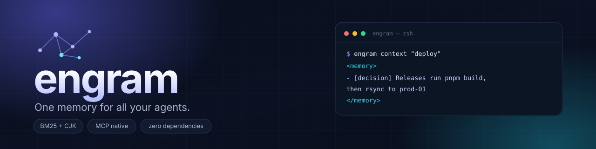
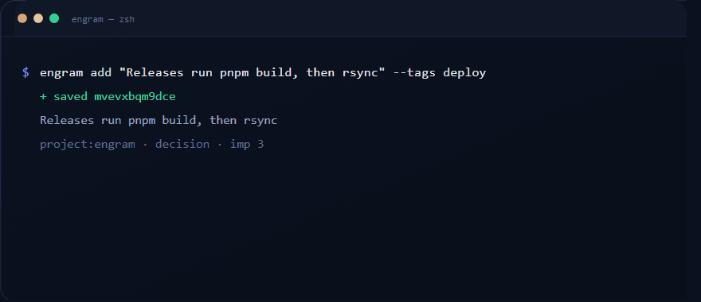

<div align="center">

<h1>engram</h1>

<p><strong>一个记忆库，给所有 Agent 用。</strong><br>
本地、可移植、MCP 原生。</p>

<p>
  <a href="https://www.npmjs.com/package/engram"></a>
  <a href="LICENSE"></a>
  <a href="package.json"></a>
  <a href="package.json"></a>
</p>

<p><a href="README.md">English</a> · 简体中文</p>



</div>

---

Agent 每次会话结束就清空记忆。包管理器用的是 pnpm 还是 npm、发布流程怎么走、命名规范是什么、上次为什么否掉那个库——每次都要从头再讲一遍。

`engram` 是一个跑在本机的**长期记忆库**，全部数据存在一个纯文本 JSONL 文件里。任何支持 [MCP](https://modelcontextprotocol.io) 的客户端都能读写它。没有服务端、没有数据库、没有向量模型、没有 API Key、没有遥测。

<p align="center">
  
</p>

```bash
$ engram add "发布流程：先 pnpm build，再 rsync 到 prod-01" --kind decision --tags deploy
+ saved mvevxbqm9dce

$ engram context "怎么发版"
<memory>
- [decision] 发布流程：先 pnpm build，再 rsync 到 prod-01
</memory>
```

**目录：** [为什么](#为什么需要它) · [特性](#特性) · [安装](#安装) · [快速开始](#快速开始) · [接入](#接入你的-agent) · [命令](#命令) · [排序](#排序是怎么算的) · [数据模型](#数据模型) · [MCP](#mcp-接口) · [配方](#常用配方) · [常见问题](#常见问题)

## 为什么需要它

- **Agent 天生无状态。** 每个新会话都从零开始，前十轮往往只是在重建你已经说过的上下文。
- **云端记忆等于被绑定。** 你的偏好和项目决策，不该是一个订阅制产品。
- **可 grep 胜过黑盒。** 整个库可以 `cat`、可以 `git diff`、可以备份、可以手改，没有任何东西藏在向量索引里。

### 横向对比

| | engram | 云端记忆 API | 向量数据库 |
| --- | --- | --- | --- |
| 存储 | 一个归你所有的 JSONL 文件 | 托管服务 | 数据库 + 向量模型 |
| 依赖 | 无（仅 Node 内置） | SDK、账号、网络 | 服务端、模型、索引 |
| 检索 | BM25，确定性 | 黑盒 | 语义、近似 |
| 离线可用 | 是 | 否 | 通常不行 |
| 可手改 | 是 | 否 | 否 |
| 最适合 | 本地 Agent 上下文 | 跨设备托管记忆 | 大规模语义语料 |

## 特性

- **单文件、零依赖** —— `~/.engram/memory.jsonl`，纯 JSONL，可读可 diff。
- **BM25 检索 + 中文支持** —— 中日韩文本按**单字 + 双字**双粒度建索引，`缩进 偏好` 能命中 `偏好 tab 缩进`，不需要分词器。
- **排序可解释** —— 相关度 × 重要度 × 时间新近度 × 作用域匹配，`--explain` 会把四个乘子全打印出来。
- **记忆有生命周期** —— 就地更新、`--replaces` 标记旧事实被取代（历史仍可查）、`prune` 清理。
- **多 Agent 并发安全** —— 建议锁 + 读改写 + 原子 rename，并行写入不丢记忆。
- **为 Agent 而生** —— 8 个 MCP 工具、2 类资源模板，以及给提示词钩子用的 `inject` 命令。
- **可脚本化** —— 所有命令支持 `--json`，退出码稳定，stdin/stdout 友好。

## 安装

```bash
npm install -g engram     # 安装后可直接使用 engram 命令
# 或者不安装直接运行
npx -y engram --help
```

需要 **Node.js ≥ 18**。

从源码构建：

```bash
git clone https://github.com/PHclaw/engram.git
cd engram
npm install
npm run build
node dist/index.js help
```

## 快速开始

```bash
# 记录值得记住的事
engram add "这个仓库用 pnpm，永远不要用 npm" --kind decision --tags tooling
engram add "缩进用 2 个空格，不要 tab" --kind preference --tags style --importance 4

# 找回来
engram search "pnpm"
engram search "缩进 偏好" --limit 3 --explain

# 生成可直接塞进提示词的记忆块
engram context "缩进用什么" --max-chars 800

# 查看与维护
engram list --all-scopes
engram stats
engram doctor
```

## 接入你的 Agent

`engram mcp` 通过 stdio 提供 MCP 服务（换行分隔的 JSON-RPC）。任何客户端都可以接。

**Claude Code**

```bash
claude mcp add engram -- npx -y engram mcp
```

**Cursor** —— `.cursor/mcp.json`

```json
{
  "mcpServers": {
    "engram": { "command": "npx", "args": ["-y", "engram", "mcp"] }
  }
}
```

**Claude Desktop** —— `claude_desktop_config.json`

```json
{
  "mcpServers": {
    "engram": { "command": "npx", "args": ["-y", "engram", "mcp"] }
  }
}
```

**Codex CLI** —— `~/.codex/config.toml`

```toml
[mcp_servers.engram]
command = "npx"
args = ["-y", "engram", "mcp"]
```

**直接指向本地构建**（不经过 npm）：

```json
{
  "mcpServers": {
    "engram": { "command": "node", "args": ["/绝对路径/engram/dist/index.js", "mcp"] }
  }
}
```

服务端会在 `initialize` 时返回 `instructions`，提示模型：回答涉及既往上下文的问题前先检索，遇到持久事实随时写入。

### 提示词钩子（客户端不支持 MCP 时）

`engram inject` 从参数或 stdin 读取提示词，输出 `<memory>` 块；**没有命中时完全不输出**，可以安全地接在钩子里往提示词追加内容。

```json
{
  "hooks": {
    "UserPromptSubmit": [
      {
        "hooks": [
          { "type": "command", "command": "engram inject" }
        ]
      }
    ]
  }
}
```

它还会自动解包 JSON 钩子载荷，依次尝试取 `prompt`、`user_prompt`、`userPrompt`、`text`、`message`、`query` 字段。

## 命令

| 命令 | 说明 |
| --- | --- |
| `add <text>` | 保存记忆；完全相同的文本会合并（标签取并集、重要度取最大）。 |
| `search <query>` | BM25 检索，按相关度 + 重要度 + 新近度 + 作用域排序。 |
| `context <query>` | 输出可直接注入提示词的 `<memory>` 块。 |
| `inject [prompt]` | 钩子用：读参数或 stdin，无命中时静默。 |
| `list` | 按更新时间倒序列出有效记忆。 |
| `get <id>` | 查看单条记忆（含时间戳与取代关系）。 |
| `update <id>` | 修改文本、类型、标签、作用域、重要度，或 `--replaces`。 |
| `rm <id>` | 删除（默认询问，`-y` 跳过）。 |
| `stats` | 总数、有效/已取代、各类型数量。 |
| `scopes` | 列出所有作用域及数量。 |
| `doctor` | 校验存储：重复 id/文本、非法类型、悬空的取代链接。 |
| `dedupe` | 查找近似重复；`--merge` 把较旧的一条标记为被取代。 |
| `prune` | 删除已被取代的记忆；`--days n` 保留近期历史。 |
| `export` | 以 JSONL 导出全部记忆。 |
| `import <file>` | 导入 JSONL 或 JSON 数组（`-` 读 stdin），保留 id 与时间戳。 |
| `mcp` | 在 stdio 上启动 MCP 服务。 |
| `help`、`version` | 用法 / 版本。 |

### 参数

| 参数 | 说明 |
| --- | --- |
| `--kind <k>` | `fact` · `preference` · `decision` · `task` · `snippet`（默认 `fact`）。 |
| `--tags a,b,c` | 逗号分隔的标签。 |
| `--tag <t>` | 按单个标签过滤读取结果。 |
| `--scope <s>` | 作用域，如 `project:engram`、`user:alice`、`global`。 |
| `--all-scopes` | 读取时不限作用域。 |
| `--include-superseded` | 读取时包含已被取代的记忆。 |
| `--importance <1-5>` | 排序权重（默认 `3`）。 |
| `--limit <n>` / `--offset <n>` | 分页。 |
| `--replaces <id>` | 标记某条旧记忆被这条新记忆取代。 |
| `--source <s>` | 记忆来源（文件、URL、对话）。 |
| `--store <path>` | 本次调用使用的存储文件（覆盖 `ENGRAM_STORE`）。 |
| `--max-chars <n>` | `context` / `inject` 的输出预算。 |
| `--days <n>` | `prune`：只清理早于 n 天的历史。 |
| `--threshold <0-1>`、`--cross-scope`、`--merge` | `dedupe` 的调参开关。 |
| `--explain` | 打印每条结果的得分构成。 |
| `--json` | 机器可读输出。 |
| `--quiet`、`-q` | 关闭人类可读提示。 |
| `--yes`、`-y` | 跳过确认。 |

### 环境变量

| 变量 | 说明 |
| --- | --- |
| `ENGRAM_STORE` | 存储路径（默认 `~/.engram/memory.jsonl`）。 |
| `NO_COLOR` | 关闭 ANSI 颜色。 |

## 排序是怎么算的

两个阶段，全部确定性。

**1. BM25**，对记忆正文 + 标签计算（`k1 = 1.2`，`b = 0.75`），池子由当前作用域/类型过滤决定：

```
idf(t) = ln(1 + (N − n(t) + 0.5) / (n(t) + 0.5))
```

中日韩文本按**单字 + 双字**切分，拉丁文本按小写单词切分，查询词去重。这样 `部署` 能命中 `部署流程`，`生产环境` 能命中 `部署到生产`——不需要分词器，也不需要模型。

**2. 乘子**：

```
score = bm25
      × (1 + 0.12 · (importance − 3))     # 0.76 … 1.24
      × (1 + 0.35 · e^(−ageDays / 45))    # 1.00 … 1.35
      × scopeBoost                        # 记忆正好在查询作用域内时 ×1.08
```

`--explain` 会把四个因子全打印出来，排序反常时可以逐项排查，而不是靠猜。

## 数据模型

一条记忆是 JSONL 里的一行：

```json
{"id":"mvevxbqm9dce","text":"这个仓库用 pnpm，永远不要用 npm","kind":"decision","tags":["tooling"],"scope":"project:engram","agent":"cli","importance":4,"createdAt":1760000000000,"updatedAt":1760000000000}
```

| 字段 | 说明 |
| --- | --- |
| `id` | `Date.now()` 的 36 进制 + 4 位随机字符。 |
| `text` | 记忆正文，写成可独立成立的陈述句。 |
| `kind` | `fact`、`preference`、`decision`、`task`、`snippet` 之一。 |
| `tags` | 自由标签，参与 BM25 索引。 |
| `scope` | 默认 `project:<目录名>`；`global` 对所有作用域可见。 |
| `importance` | 1–5，自动截断。 |
| `supersededBy` | 被更新的记忆取代时写入。 |
| `createdAt` / `updatedAt` | 毫秒时间戳。 |

**生命周期**：事实会变，但不要删除历史，而是标记取代。

```bash
engram add "发布改用 rsync 到 prod-01" --replaces mvevxbqm9dce  # 旧记录仍可用 --include-superseded 查到
engram prune --days 30                                          # 清理不再需要的历史
```

写入通过 `<store>.lock` 串行化（10 秒未释放视为崩溃残留并回收），并用唯一临时文件 + 原子 rename 提交，Windows 上的 `EPERM` 会退避重试。多个 Agent 同时写同一个库也不会丢更新。

## MCP 接口

**工具**

| 工具 | 用途 |
| --- | --- |
| `memory_add` | 保存事实、偏好、决策、任务或代码片段。 |
| `memory_search` | 排序检索，返回 id、正文、标签与得分。 |
| `memory_context` | 把命中的记忆包进 `<memory>` 块。 |
| `memory_list` | 按更新时间倒序列出。 |
| `memory_get` | 按 id 取完整 JSON。 |
| `memory_update` | 局部更新字段。 |
| `memory_delete` | 永久删除一条记忆。 |
| `memory_stats` | 总数、各类型数量、作用域、存储路径。 |

**资源**

| URI | 内容 |
| --- | --- |
| `engram://stats` | 存储概要。 |
| `engram://scope/{scope}` | 某个作用域下的全部记忆。 |
| `engram://memory/{id}` | 单条记忆的 JSON。 |

协议版本 `2024-11-05`；stdin/stdout 上的换行分隔 JSON-RPC，stdout 只用于协议消息。

## 常用配方

```bash
# 备份、换机器、给第二个 Agent 播种
engram export > backup.jsonl
ENGRAM_STORE=~/.engram/work.jsonl engram import backup.jsonl

# 让所有项目共享一条约定
engram add "提交前必须跑测试" --scope global --kind preference

# 发版前体检
engram doctor
engram dedupe --threshold 0.75
engram stats --json | jq '.byKind'

# 给长任务喂上下文
engram context "当前任务：重构鉴权" --limit 10 --max-chars 2000
```

## 设计原则

- **零依赖。** 只用 Node 内置模块，不引入安装期供应链。
- **本地优先。** 不发网络请求、不要账号、不做遥测。
- **检索可解释。** BM25 加四则运算，人能读懂；没有向量漂移。
- **存储要朴素。** JSONL 能活过 `cat`、`grep`、`git` 和 `rsync`。
- **非目标：** 不做向量数据库、不替你跨机器同步、不保存密钥。凭据别写进记忆。

## 常见问题

**为什么不用 SQLite 或向量检索？**
因为整个库应该能装进脑子里：一个文件、没有二进制格式、不用下模型、不用重建索引。BM25 加中文双字足以覆盖"我之前跟你说过的那个"，几千条规模下依然很快。

**记忆存在哪？**
默认 `~/.engram/memory.jsonl`，可用 `ENGRAM_STORE` 或 `--store` 覆盖。项目记忆默认 `project:<当前目录名>`，`global` 记忆对所有作用域可见。

**两个 Agent 同时写会覆盖吗？**
不会。写入方先拿锁、重新加载、修改，再原子提交；读取方永远看不到写了一半的文件。

**Windows 能用吗？**
在 Windows 11 + Node 20 上验证过。rename 重试覆盖杀软/索引器造成的 `EPERM`、`EBUSY`。日志要干净可以设 `NO_COLOR=1`。

**能手动改文件吗？**
可以，就是 JSONL。改完跑一次 `engram doctor`，它会报告重复 id、非法类型和悬空的取代链接。

## 开发

```bash
npm install
npm run build     # tsc → dist/
npm test          # 构建 + 39 项端到端检查（CLI + MCP + 并发）
npm run clean
```

```
src/store.ts    JSONL 存储、作用域、按哈希去重、加锁、原子写
src/search.ts   BM25、CJK 分词、排序乘子、上下文块
src/dedupe.ts   Jaccard 近似重复检测
src/cli.ts      子命令与终端输出
src/mcp.ts      MCP stdio 服务（工具 + 资源）
src/args.ts     零依赖参数解析
src/ui.ts       颜色、对齐、相对时间
scripts/smoke.js  端到端测试脚本
assets/         横幅 banner.svg、动画源文件 demo.svg、成品 demo.gif
```

欢迎贡献：先开 issue 说明场景，守住零依赖底线，任何用户可见的改动都补一条 smoke 检查。

## 许可证

[MIT](LICENSE) © engram contributors

<div align="center"><sub>名字取自 <em>engram</em>——记忆在神经系统中留下的物理痕迹。</sub></div>
